<a href="https://snehalsportfolio2027.netlify.app">
  
</a>

  

  
  
  
  
  




<a href="https://github.com/snehalghadge59-blip/AeroFaultAI">
  
</a>

  

  

<a href="https://github.com/snehalghadge59-blip/InsightRAG">
  
</a>

  


<!-- Tech Stack Skill Icons with Logos -->

  <b>📊 Data Analytics &amp; Business Intelligence</b> 
  

  
  
  
  

  <b>🤖 AI, Machine Learning &amp; Deep Learning</b> 
  

  <b>💻 Programming Languages &amp; Core</b> 
  

  <b>☁️ Cloud, Databases &amp; DevOps</b> 
  

  <b>🛠️ Developer &amp; Data Tools</b> 
  


  

  
  &nbsp;
  

<a href="https://snehalsportfolio2027.netlify.app">
  
</a>


  
  
  
  

